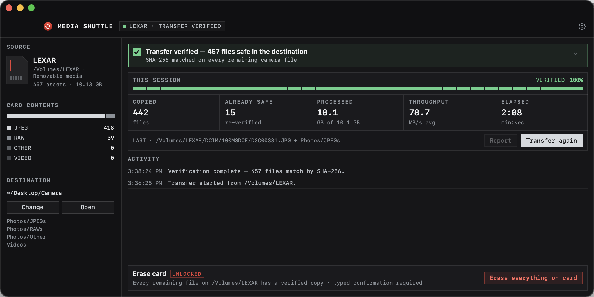
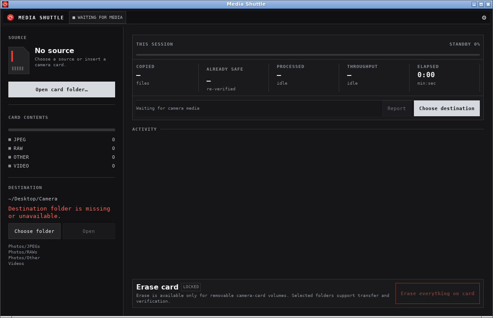

# Media Shuttle

**Verified camera-card ingest for macOS, Windows, and Linux.**

Media Shuttle sorts photos and videos into a predictable folder layout, checks every copy with SHA-256, and keeps card erase locked until the source and destination still match.

<div align="center">
  
</div>

[](#download)
[](#download)
[](#build)
[](#build)
[](#build)
[](LICENSE)

## What it does

- Finds camera media in `DCIM`, `M4ROOT`, and `PRIVATE` folders.
- Sorts files into `Camera/Photos/JPEGs`, `Camera/Photos/RAWs`, `Camera/Photos/Other`, and `Camera/Videos`.
- Writes to a temporary file, hashes the card copy and destination copy independently, and publishes only when they match.
- Reuses identical files already at the destination and keeps different name collisions.
- Watches for cards in the background, with optional automatic transfer and native notifications.
- Opens a camera card folder manually when automatic detection misses it. Use the Source panel, Ctrl+O on Windows, or File → Open Camera Card Folder on macOS.

Erase is available only after a verified transfer. Before deleting, the app rescans the card and verifies every remaining file against its destination copy. Unknown files keep erase locked. Erasing removes user content; it does not format the card. Type `ERASE EVERYTHING` to confirm. Use the camera's Format command when you need a fresh filesystem.

## Download

Get the latest installer and portable build from [GitHub Releases](https://github.com/AdamNolle/media-shuttle/releases).

- **Windows:** run `MediaShuttle-Setup-v*-win-x64.exe`, or unzip `MediaShuttle-v*-win-x64.zip`. The build is self-contained; no .NET runtime install is needed.
- **macOS:** open `MediaShuttle-v*-macOS-universal.dmg` and drag the app to Applications.
- **Linux:** build from this source tree using the instructions below. A Linux release bundle is not published yet.

Each release includes a platform-specific SHA-256 checksum file. Unsigned Windows builds may show SmartScreen; unsigned macOS community builds may require Control-click → **Open**.

## Build

### Windows

Requires the .NET 8 SDK and Inno Setup 6 to build the installer.

```powershell
.\windows\build.ps1 -Clean
.\windows\install.ps1
```

Use `-SkipInstaller` for a portable-only build. `build.ps1` runs the core safety suite before packaging.

### macOS

Requires Xcode 26 or later and Swift 6.

```bash
swift run --package-path macos MediaShuttle
swift test --package-path macos --scratch-path /tmp/media-shuttle-tests
./macos/scripts/package-macos.sh 0.1.2
```

### Linux

The Linux app is written for GTK 3 with PyGObject and uses the system Python 3, GTK, Cairo bindings, and desktop services. On Ubuntu or Debian, install `python3-gi`, `gir1.2-gtk-3.0`, `python3-gi-cairo`, and `python3-cairo` from your distribution. Other distributions provide equivalent GTK 3 introspection and Cairo packages. Run it directly:

```bash
./linux/media-shuttle
PYTHONPATH=linux python3 -m unittest discover -s linux/tests -v
```

For a rootless desktop installation, run `./linux/install.sh`. It installs the app and icon under your XDG user data directory and links the launcher at `~/.local/bin/media-shuttle`. The desktop environment draws the window title bar and controls; the app retains its dark status row beneath them. No .NET or Swift runtime is required on Linux.



Automatic card detection uses mounted camera volumes containing `DCIM`, `M4ROOT`, or `PRIVATE`; a source folder can also be selected manually. Erase is limited to a removable mounted volume root. The Linux app checks the source and destination again with SHA-256 before deleting card content and preserves known system-managed root entries. A manually selected folder can transfer and verify, but cannot be erased. Linux desktop distributions differ in GTK theme, fonts, window decorations, mount permissions, and packaging, so visual output can vary slightly even though the app body uses the same dimensions, colors, and artwork.

## CI and releases

GitHub Actions runs Windows, macOS, and Linux safety checks on pushes and pull requests. Linux CI also starts the GTK window in a virtual display. Pull requests from forks use GitHub-hosted runners for isolation. Tagged Windows releases run on Adlon, while macOS releases run on the Mac runner. Both release workflows test and attach their packages to the same GitHub release.

## Privacy

Settings, transfer records, and logs stay on the computer. Media Shuttle makes no network requests and collects no analytics.

## License

[MIT](LICENSE)
